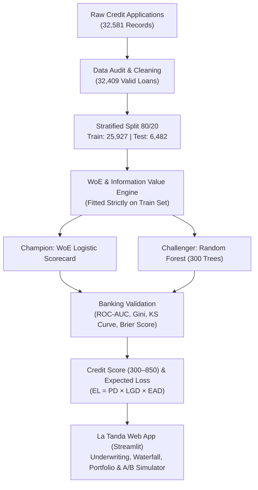

# La Tanda: Credit Risk Scoring & Portfolio Optimization Engine

[](https://www.python.org/)
[](https://creditrisklatanda.streamlit.app/)
[](https://scikit-learn.org/)
[](https://opensource.org/licenses/MIT)

**Live Interactive Dashboard:** [https://creditrisklatanda.streamlit.app/](https://creditrisklatanda.streamlit.app/)

An independent, personal Data Science project exploring how digital lenders and Fintech platforms make real-time credit underwriting decisions—balancing approval volume, default risk, and portfolio profitability.

Rather than stopping at a simple classification score, **La Tanda** connects statistical modeling directly to business economics: it translates default probabilities ($PD$) into a **300–850 Credit Score**, explains each applicant's score step by step, estimates **Expected Loss ($EL$)**, and simulates a **Champion vs. Challenger** rollout strategy to test model upgrades safely.

> **Note on Localization:** All documentation and technical reports are written in English, while the interactive Streamlit application is localized in Spanish for a Latin American Fintech context.

---

## Why I Built This Project

Coming from an Actuarial Science and Financial Consulting background, I wanted to build a practical, hands-on credit scoring tool out of personal interest to see how modern machine learning compares against traditional banking scorecards.

In real lending operations, three things matter most:

1. **Explainability over black boxes:** Credit committees and regulators need to know *why* a loan was approved or declined, not just a raw probability.
2. **Financial impact over pure accuracy:** Approving fewer defaults is great, but the real question is: *at what risk cutoff does the company actually maximize net profit?*
3. **Safe model governance:** Even when a new machine learning model outperforms the incumbent on paper, banks don't switch overnight—they validate it gradually through Champion vs. Challenger A/B testing.

---

## How the System Works

### 1. Data Audit & Cleanup
Starting from **32,581 historical loan applications**, the ETL pipeline (`src/data_prep.py`) cleans the dataset down to **32,409 valid records**:
* Removed **165** exact duplicate applications.
* Filtered **7** impossible data entry errors (such as recorded ages over 95 or employment lengths over 60 years).
* Imputed missing interest rates using the median within each credit grade (`loan_grade`), preserving risk structure without leaking test information.
* Observed portfolio baseline: **21.87%** historical default rate (`7,088` defaults vs. `25,321` paid loans).

### 2. Feature Ranking (Weight of Evidence & Information Value)
Before training, numerical and categorical variables were transformed using **Weight of Evidence (WoE)** strictly on the training set ($N = 25,927$). The **Information Value (IV)** measures how strongly each variable separates good payers from defaulters:

| Rank | Feature | Business Meaning | Information Value (IV) | Predictive Strength |
| :---: | :--- | :--- | :---: | :--- |
| **1** | `loan_grade` | Preliminary Credit Bureau Grade (A–G) | **0.8782** | Very Strong |
| **2** | `loan_percent_income` | Debt-to-Income Ratio (Loan / Annual Income) | **0.7692** | Very Strong |
| **3** | `loan_int_rate` | Assigned Annual Interest Rate (%) | **0.7139** | Very Strong |
| **4** | `person_income` | Applicant Annual Income ($ USD) | **0.4647** | Very Strong |
| **5** | `person_home_ownership` | Home Ownership (Own, Mortgage, Rent) | **0.3811** | Very Strong |
| **6** | `cb_person_default_on_file` | Historical Default Record (Yes/No) | **0.1486** | Strong |
| **7** | `loan_intent` | Purpose of the Loan (Venture, Medical, Debt, etc.) | **0.0906** | Moderate |
| **8** | `loan_amnt` | Requested Loan Amount ($ USD) | **0.0802** | Moderate |
| **9** | `person_emp_length` | Employment / Business Tenure (Years) | **0.0512** | Moderate |

*(Key insight: Client age and credit history length alone had IV < 0.01—cash flow burden relative to income matters far more than age).*

### 3. Model Benchmark: Champion vs. Challenger ($N = 6,482$ Out-of-Sample)
I pitted a transparent, regulator-friendly banking scorecard (**Champion**) against a non-linear ensemble (**Challenger**) on **6,482 unseen test loans**:

| Role | Model Architecture | ROC-AUC | Gini Index | KS Statistic | Brier Score | Accuracy |
| :--- | :--- | :---: | :---: | :---: | :---: | :---: |
| **Champion** | Logistic Regression (WoE Scorecard) | 0.8746 | 0.7493 | 62.62% | 0.1018 | 85.7% |
| **Challenger** | **Random Forest Classifier (300 Trees)** | **0.9330** | **0.8661** | **72.98%** | **0.0578** | **93.0%** |

* **Why Random Forest wins on performance:** It captures non-linear combinations (for instance, a moderate-income applicant requesting a small business loan while owning a home) that linear weights miss, boosting KS separation by **+10.36 percentage points**.
* **Why the WoE Scorecard stays valuable:** It powers the step-by-step **Score Waterfall breakdown** (scaled from 300 to 850 points), showing the exact point contribution of every feature.

---

## System Architecture



---

## Business Impact & Champion vs. Challenger Rollout

Evaluating real financial outcomes across the **6,482 test loans** (assuming 75% Loss Given Default):

* **No Model (Approve 100%):** A 21.88% default rate leads to a net portfolio loss of **-\$6,648,263 USD**.
* **Champion (WoE Scorecard @ 22% PD Cutoff):** Approves 4,326 loans with 6.29% default rate, turning a profit of **+\$2,159,001 USD**.
* **Challenger (Random Forest @ 22% PD Cutoff):** Approves **4,946** loans at an even lower 5.66% default rate, reaching **+\$2,526,382 USD** (**+\$367,382 USD** above the Champion, and **+\$9.17M USD** total value added over baseline).

To bridge this upgrade safely in production, the **Model Audit** tab includes an interactive **A/B Traffic Simulator** backed by a 3-stage governance roadmap:
1. **Shadow Mode:** The Challenger scores live applications silently in parallel to verify stability.
2. **Controlled Pilot:** A small share of traffic (e.g., 20%) is routed to the Challenger to confirm incremental profit without risking the whole portfolio.
3. **Champion Promotion:** Once real loan vintages confirm consistency and compliance, the Challenger becomes the new Champion.

---

## Interactive Web App Features

Built in **Streamlit** and **Plotly** with a clean **Warm Copper & Slate** executive design:
* **Individual Underwriting:** Full applicant dossier with an interactive **300–850 Credit Score Gauge**, expected profit/loss ledger, break-even interest rate, and **Score Waterfall Chart**.
* **Portfolio Simulator:** Adjust maximum default tolerance and loss severity (LGD) to visualize the net profit curve across all 6,482 loans.
* **Model Audit:** Compare Champion vs. Challenger metrics, inspect the **Kolmogorov-Smirnov (KS) curve**, review **Information Value (IV)** rankings, and simulate A/B traffic splits.

---

## Quickstart & Local Setup

```bash
# 1. Clone the repository
git clone https://github.com/JavsG19/credit-risk-scoring-engine.git
cd credit-risk-scoring-engine

# 2. Install dependencies
pip install -r requirements.txt

# 3. Launch La Tanda web application
streamlit run app.py
```

---

## Repository Structure

```text
├── .streamlit/
│   └── config.toml          # Warm Copper & Slate theme configuration
├── data/
│   ├── raw/                 # Original credit risk dataset
│   └── processed/           # Audited & cleaned loan records (32,409 rows)
├── models/
│   ├── credit_risk_artifacts.joblib
│   ├── benchmark_results.csv
│   ├── iv_summary.csv
│   └── test_portfolio_predictions.csv
├── src/
│   ├── data_prep.py         # Automated download, audit & cleaning pipeline
│   ├── models.py            # WoE/IV engine, Logistic Scorecard & Random Forest
│   └── predictor.py         # Underwriting inference, EL & portfolio simulator
├── app.py                   # La Tanda Streamlit executive dashboard
├── requirements.txt         # Project dependencies
└── README.md                # Project documentation
```

---

## Javier García Sánchez

**Actuarial Science & Data Science**

[Live Web App](https://creditrisklatanda.streamlit.app/) · [LinkedIn](https://www.linkedin.com/in/javier-hern%C3%A1n-garc%C3%ADa-s%C3%A1nchez-28328b15b/) · [GitHub](https://github.com/JavsG19)

> *Disclaimer: Built as a personal portfolio project for educational and quantitative analytics demonstration purposes.*
