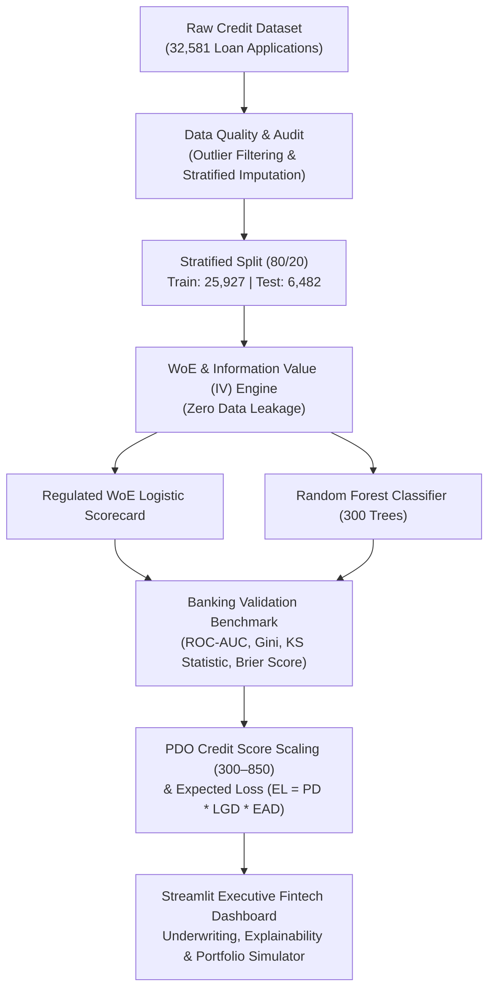

# CreditIQ Analytics: Credit Risk Scoring & Portfolio Optimization Engine

[](https://www.python.org/)
[](https://streamlit.io/)
[](https://scikit-learn.org/)
[](https://opensource.org/licenses/MIT)

An end-to-end **Credit Risk Underwriting & Portfolio Economics Engine** designed for digital lending platforms (Fintech / SME & Consumer Credit).

The pipeline transforms raw loan applications (**32,409 cleaned records**) through **Weight of Evidence (WoE) & Information Value (IV)** risk engineering, benchmarks a regulatory **WoE Logistic Scorecard** against a **300-tree Random Forest Classifier**, scales probabilities of default ($PD$) into a **300–850 Credit Score**, and optimizes portfolio cutoff thresholds based on **Expected Loss ($EL = PD \times LGD \times EAD$)**.

---

## Key Highlights & Business Impact

* **Dataset & Quality Audit:** 32,581 loan applications audited and cleaned to **32,409 valid records** (removing 165 exact duplicates and 7 recording anomalies, with grade-stratified median imputation).
* **Regulatory Feature Engineering (WoE & IV):** Quantile and categorical Weight of Evidence encoding fitted strictly on training data ($N = 25,927$) to avoid data leakage.
* **Model Benchmark (Unseen Test Set: $N = 6,482$):**
  * **WoE Logistic Scorecard:** `ROC-AUC = 0.8746` | `Gini = 0.7493` | `KS = 62.62%` | `Brier = 0.1018`
  * **Random Forest (300 Trees):** `ROC-AUC = 0.9330` | `Gini = 0.8661` | `KS = 72.98%` | `Brier = 0.0578`
* **Portfolio Financial Optimization:** On the 6,482 unseen test loans, applying an optimal $PD \le 22\%$ approval policy transforms a baseline portfolio loss of **-\$6.65M USD** into a net profit of **+\$2.53M USD** (**+\$9.17M USD value added**).

---

## System Architecture



---

## Information Value (IV) Feature Ranking

| Rank | Feature | Business Description | Information Value (IV) | Predictive Power |
| :---: | :--- | :--- | :---: | :--- |
| **1** | `loan_grade` | Preliminary Credit Bureau Grade (A–G) | **0.8782** | Very Strong |
| **2** | `loan_percent_income` | Loan-to-Income Ratio (DTI) | **0.7692** | Very Strong |
| **3** | `loan_int_rate` | Assigned Annual Interest Rate (%) | **0.7139** | Very Strong |
| **4** | `person_income` | Annual Applicant Income ($ USD) | **0.4647** | Very Strong |
| **5** | `person_home_ownership` | Home Ownership Status | **0.3811** | Very Strong |
| **6** | `cb_person_default_on_file` | Historical Bureau Default on File (Y/N) | **0.1486** | Strong |
| **7** | `loan_intent` | Loan Purpose / Intent | **0.0906** | Moderate |
| **8** | `loan_amnt` | Requested Loan Principal ($ USD) | **0.0802** | Moderate |
| **9** | `person_emp_length` | Employment / Business Tenure (Years) | **0.0512** | Moderate |

---

## Out-of-Sample Benchmark Results ($N = 6,482$)

| Model Architecture | ROC-AUC | Gini Index | KS Statistic | Brier Score | Accuracy | F1-Score |
| :--- | :---: | :---: | :---: | :---: | :---: | :---: |
| **WoE Logistic Scorecard** | 0.8746 | 0.7493 | 62.62% | 0.1018 | 85.7% | 0.6846 |
| **Random Forest (300 Trees)** *(Selected)* | **0.9330** | **0.8661** | **72.98%** | **0.0578** | **93.0%** | **0.8239** |

---

## Quickstart & Local Setup

```bash
git clone https://github.com/JavsG19/credit-risk-scoring-engine.git
cd credit-risk-scoring-engine
pip install -r requirements.txt
streamlit run app.py
```

---

## Javier García Sánchez

**Actuarial Science & Data Science**

[LinkedIn](https://www.linkedin.com/in/javier-hern%C3%A1n-garc%C3%ADa-s%C3%A1nchez-28328b15b/) · [GitHub](https://github.com/JavsG19)
