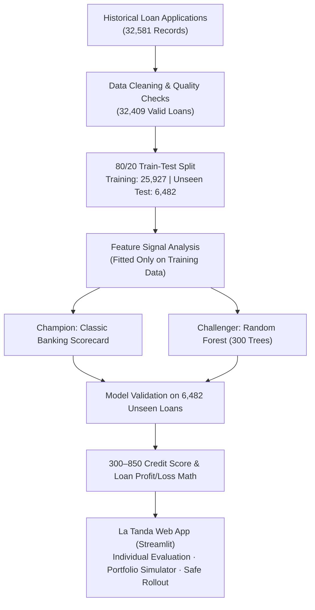

# La Tanda: Credit Risk Scoring & Portfolio Simulator

[](https://www.python.org/)
[](https://creditrisklatanda.streamlit.app/)
[](https://scikit-learn.org/)
[](https://opensource.org/licenses/MIT)

**Live Interactive Web App:** [https://creditrisklatanda.streamlit.app/](https://creditrisklatanda.streamlit.app/)

An independent **Data Science portfolio project** exploring how digital lenders and Fintech companies decide which loans to approve—balancing growth, default risk, and overall profitability.

Rather than stopping at a raw "yes/no" prediction, **La Tanda** connects machine learning directly to real business decisions: it converts each applicant's risk of non-payment into an easy-to-read **300–850 Credit Score**, breaks down **why** that person received that score point by point, estimates expected profit or loss in dollars, and simulates how a company can safely roll out a new model without risking its entire loan book.

> **Note on Language:** Project documentation is written in English, while the interactive web app is in Spanish for a Latin American Fintech setting.

---

## Why I Built This Project

Coming from an Actuarial Science and Financial Consulting background, I wanted to build a practical, visual project for my portfolio showing how credit decisions actually work behind the scenes.

In real lending, three questions matter far more than abstract math:

1. **Can we explain the decision clearly?** Both applicants and credit teams need to see *which factors helped or hurt a score*, not just an opaque black-box percentage.
2. **Where is the sweet spot for profitability?** Rejecting almost everyone avoids defaults, and approving everyone creates huge losses—the real goal is finding the approval threshold that maximizes net profit.
3. **How do banks upgrade models safely?** Even when a newer Machine Learning model is more accurate, lenders test it gradually on a small slice of applications (*Champion vs. Challenger*) before making it the main system.

---

## How It Works (Step by Step)

### 1. Data Cleaning & Preparation
Starting from **32,581 historical loan applications**, the cleaning pipeline (`src/data_prep.py`) prepares **32,409 valid records**:
* Removed **165** duplicate applications.
* Filtered out **7** unrealistic data entry errors (such as recorded ages above 95 or employment lengths over 60 years).
* Filled missing interest rates using the typical rate of borrowers in the same credit grade, avoiding any distortion.
* Historical baseline: **21.87%** of loans in the dataset ended in default (`7,088` unpaid vs. `25,321` paid back).

### 2. What Matters Most When Predicting Repayment?
Before training the models, we measure how strongly each piece of applicant information separates reliable borrowers from defaults (using an industry metric called **Information Value**, where anything above `0.30` is considered a very strong signal):

| Rank | Applicant Factor | Plain-Language Meaning | Signal Strength (IV) | Impact Level |
| :---: | :--- | :--- | :---: | :--- |
| **1** | `loan_grade` | Preliminary Credit Bureau Grade (A to G) | **0.8782** | Very Strong |
| **2** | `loan_percent_income` | Loan Size Relative to Annual Income | **0.7692** | Very Strong |
| **3** | `loan_int_rate` | Assigned Annual Interest Rate (%) | **0.7139** | Very Strong |
| **4** | `person_income` | Applicant Annual Income (USD) | **0.4647** | Very Strong |
| **5** | `person_home_ownership` | Housing Status (Own, Mortgage, Rent) | **0.3811** | Very Strong |
| **6** | `cb_person_default_on_file` | Past Default on Credit Record (Yes/No) | **0.1486** | Strong |
| **7** | `loan_intent` | Purpose of the Loan (Business, Medical, Debt, etc.) | **0.0906** | Moderate |
| **8** | `loan_amnt` | Requested Loan Amount (USD) | **0.0802** | Moderate |
| **9** | `person_emp_length` | Years at Current Job or Business | **0.0512** | Moderate |

*(Takeaway: Age and years on file barely matter on their own—how heavy the loan payment is compared to the person's income matters much more).*

### 3. Comparing Two Approaches on 6,482 Unseen Loans
We tested a classic, transparent **Banking Scorecard** (*Champion*) against a **Random Forest Machine Learning model** (*Challenger*) on **6,482 held-out loan applications**:

**How to read the comparison metrics:**
* **ROC-AUC & Gini:** Overall ability to rank risky applicants above safe ones *(closer to 1.00 is better)*.
* **KS Separation:** How cleanly the model separates people who pay from people who default *(higher % is better)*.
* **Accuracy:** Percentage of correct predictions overall *(higher % is better)*.
* **Brier Score:** Calibration error of the predicted probabilities *(closer to 0.00 is better)*.

| Role | Model Type | ROC-AUC | Gini | KS Separation | Brier Score | Accuracy |
| :--- | :--- | :---: | :---: | :---: | :---: | :---: |
| **Champion (Current)** | Classic Banking Scorecard (Logistic Regression) | 0.8746 | 0.7493 | 62.62% | 0.1018 | 85.7% |
| **Challenger (New)** | **Random Forest (300 Decision Trees)** | **0.9330** | **0.8661** | **72.98%** | **0.0578** | **93.0%** |

* **Why Random Forest is more accurate:** It spots combined patterns (for example, a moderate-income homeowner borrowing a modest amount to grow a business) that straight-line formulas miss.
* **Why we still keep the Classic Scorecard:** It lets us show the exact **points added or subtracted** by each factor on the `300–850` Credit Score chart.

---

## Project Flow



---

## Financial Impact Across the 6,482 Test Loans

Assuming that when a loan defaults the lender loses **75% of the unpaid principal**, here is what happens under three policies:

* **Approving Everyone (No Filter):** A 21.88% default rate produces a net loss of **-\$6,648,263 USD**.
* **Champion Scorecard (Approve up to 22% risk):** Approves 4,326 loans with a 6.29% default rate, earning **+\$2,159,001 USD**.
* **Challenger Random Forest (Approve up to 22% risk):** Approves **4,946** good loans at an even lower 5.66% default rate, earning **+\$2,526,382 USD** (**+\$367,382 USD** more than the Champion).

To show how a lender adopts that improvement safely, the app includes a **3-step rollout simulator**:
1. **Shadow Mode:** Run the new model silently in the background without affecting real approvals yet.
2. **Controlled Pilot (A/B Test):** Route a small share of live applications (e.g., 20%) to the new model to verify extra profit with limited risk.
3. **Full Promotion:** Once real repayment results confirm stability, promote the Challenger as the main model.

---

## Interactive Web App Overview

* **1. Individual Evaluation:** Pick a sample profile or customize income, loan amount, interest rate, and credit history to see the instant verdict, **300–850 Score Gauge**, expected profit/loss in USD, and a **Score Breakdown Waterfall** showing which factors helped or hurt.
* **2. Portfolio Simulator:** Move the risk tolerance slider to see how approval rate, default rate, and total net profit change across all 6,482 loans.
* **3. Model Audit & Safe Rollout:** Side-by-side model comparison with plain-language metric guides, separation curves, factor importance rankings, and an interactive A/B traffic slider.

---

## Run Locally

```bash
# 1. Clone the repository
git clone https://github.com/JavsG19/Credit-Risk-La-Tanda.git
cd Credit-Risk-La-Tanda

# 2. Install dependencies
pip install -r requirements.txt

# 3. Launch La Tanda web app
streamlit run app.py
```

---

## Project Structure

```text
├── .streamlit/
│   └── config.toml          # Warm Copper & Slate theme configuration
├── data/
│   ├── raw/                 # Original credit risk dataset
│   └── processed/           # Cleaned loan records (32,409 rows)
├── models/
│   ├── credit_risk_artifacts.joblib
│   ├── benchmark_results.csv
│   ├── iv_summary.csv
│   └── test_portfolio_predictions.csv
├── src/
│   ├── data_prep.py         # Data download, audit & cleaning pipeline
│   ├── models.py            # Scorecard & Random Forest training
│   └── predictor.py         # Applicant scoring & portfolio simulator
├── app.py                   # La Tanda Streamlit web application
├── requirements.txt         # Python dependencies
└── README.md                # Project documentation
```

---

## Javier García Sánchez

**Actuarial Science & Data Science**

[Live Web App](https://creditrisklatanda.streamlit.app/) · [LinkedIn](https://www.linkedin.com/in/javier-hern%C3%A1n-garc%C3%ADa-s%C3%A1nchez-28328b15b/) · [GitHub](https://github.com/JavsG19)

> *Disclaimer: Personal Data Science portfolio project created strictly for educational and analytical demonstration purposes.*
